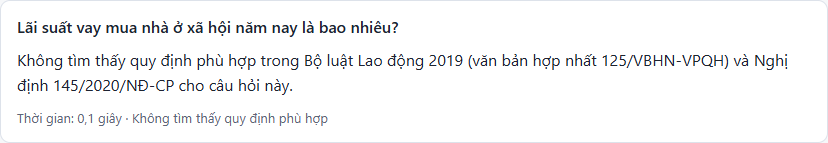
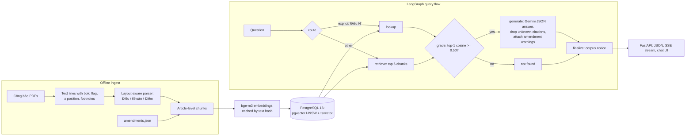

# Vietnamese Labor Law Assistant (RAG)

[](https://github.com/manhth197/vn-labor-law-rag/actions/workflows/ci.yml)

Question answering over Vietnamese labor law (Bộ luật Lao động 2019, Nghị định 145/2020). Retrieval runs on PostgreSQL + pgvector and LangGraph orchestrates the flow. LLM answers cite every article and clause, and the citations are checked in code.

- **Structured ingestion:** a layout-aware parser turns the official gazette PDFs into Điều / Khoản / Điểm (inserted clauses such as "8a" and footnotes included), and each article becomes one retrieval chunk.
- **Measured choices:** vector, keyword and hybrid retrieval were compared on a golden set, and the LLM was picked by success rate and latency. Answers are scored with deterministic metrics first; an LLM judge is a secondary check.
- **Guarded answers:** every citation must belong to the retrieved chunks, weak retrieval scores stop before the LLM is called, and amendment warnings come from metadata, not from the model.
- **Shipping:** FastAPI with SSE streaming, a Vietnamese chat UI, an MCP server for agent clients, Docker Compose, and GitHub Actions CI (with a pgvector service) that never calls a paid API.

**Not legal advice.** Notice shown with answers: *Theo VBHN 125/VBHN-VPQH (2025); một số quy định sẽ thay đổi từ 01/03/2027.* The Labor Code used here is the consolidated text 125/VBHN-VPQH, i.e. the law in force including amendments up to 27/08/2025. Nghị định 145/2020/NĐ-CP is the original text. Changes announced after that are tracked in [an amendment registry](#amendments) and flagged on the articles they touch.

| Answer with citation | Holiday question with the 01/03/2027 warning | Out of scope |
|---|---|---|
|  |  |  |

## Architecture



Design: [docs/ARCHITECTURE.md](docs/ARCHITECTURE.md). Every non-obvious choice has a short decision note ([list below](#design-decisions)).

## Results

Golden set: 77 questions (lookup, paraphrase, multi-article, numeric, out of scope), drafted by the coding agent. The owner reviewed a stratified sample of 25 and accepted 22 (the 3 left blank were the out-of-scope items). The **reviewed answerable questions (n=22)** are the main numbers. This is a small sample: one question moves a rate by 4.5 points. Full tables with dates, git revisions and per-type breakdowns are in [docs/EVAL.md](docs/EVAL.md).

**Retrieval** (`python -m vnlaw_rag.cli eval`, no LLM):

| Configuration | Hit@1 (n=22) | Hit@5 (n=22) | MRR@10 (n=22) | Hit@5 (all 67 answerable) |
|---|---|---|---|---|
| **vector only, bge-m3 (default)** | 0.864 | 0.909 | 0.891 | 0.955 |
| keyword: syllable pairs + BM25-style IDF in SQL | 0.591 | 0.773 | 0.667 | 0.731 |
| keyword: syllable pairs + `ts_rank_cd` | 0.045 | 0.227 | 0.152 | 0.313 |
| hybrid RRF (vector + IDF keyword, function words dropped) | 0.773 | 0.955 | 0.829 | 0.940 |

Vector-only is the default. Hybrid finds one more reviewed question in the top 5 but ranks the right article lower on average ([decision 005](docs/decisions/005-retrieval-mode-vector-default.md)). Hybrid stays available with `RETRIEVAL_MODE=hybrid`.

**Answers** (`python -m vnlaw_rag.cli eval-answers`; generator and judge `gemini-3.5-flash-lite`, sequential requests). These numbers are for the current configuration (`GRADE_MIN_SCORE=0.50`):
- Full run on 2026-11-24 (git 830902c): 148 API requests, 11 failed (7.4%), all 77 questions scored.
- Re-run of the 2 questions affected by the later threshold change (git aed54ed): 3 requests, 0 failed.

| Metric | Reviewed (n=22) | All (n=77) |
|---|---|---|
| Answered (answerable questions) | 0.909 | 0.955 |
| Citation precision / recall (article level) | 0.975 / 0.950 | 0.948 / 0.977 |
| Numeric exact match (key figure) | 7/8 | 22/23 |
| Out-of-scope questions refused | - | 10/10 |
| Judge correctness / faithfulness, 1-5 (secondary) | 5.00 / 4.95 | 4.94 / 4.97 |

The deterministic rows are the main numbers. The judge is the same model as the generator, so its scores are a sanity check only. The 3 remaining wrong refusals are retrieval misses (the right article was ranked too low or not found), and in each case the system answered "không tìm thấy" instead of guessing. The full run (answered 0.864 / 0.940 under the old 0.55 threshold) and every post-run change are recorded in [docs/EVAL.md](docs/EVAL.md) and [decision 009](docs/decisions/009-answer-evaluation.md).

**LLM latency** (`python -m vnlaw_rag.cli bench-llm`, 5 reviewed questions per model, 2026-11-24):
- gemini-3.5-flash-lite answered 4/5 within the 25 s limit (p50 1.7 s, p95 2.0 s).
- gemini-4-hydrogen and gemini-3.8-flash answered 0/5 within 25 s.

Details: [decision 008](docs/decisions/008-llm-latency-policy-and-streaming.md).

## Quick start

### Local

Requires Python 3.10+ and Docker (for PostgreSQL + pgvector).

```bash
python -m venv .venv
# Windows: .venv\Scripts\activate    macOS/Linux: source .venv/bin/activate
pip install --no-cache-dir torch --index-url https://download.pytorch.org/whl/cpu   # CPU-only PyTorch first
pip install -e ".[dev]"            # app + tests
pip install -e ".[ingest]"         # only to re-extract text from the PDFs (PyMuPDF, AGPL)
pip install -e ".[mcp]"            # only for the MCP server

python -m vnlaw_rag.cli fetch      # optional: download the gazette PDFs to data/raw (3 requests)
python -m vnlaw_rag.cli parse      # PDF -> data/interim -> data/processed (the outputs are committed)

docker compose up -d db            # pgvector/pgvector:pg16 on 127.0.0.1:5442
python -m vnlaw_rag.cli index      # embed 348 chunks with bge-m3 and load them (one command)
python -m vnlaw_rag.cli search "Thời gian thử việc tối đa là bao lâu?"

cp .env.example .env               # then set GEMINI_API_KEY
python -m vnlaw_rag.cli ask "Người lao động được nghỉ Tết Âm lịch mấy ngày?"
python -m vnlaw_rag.cli serve      # API + chat UI on http://127.0.0.1:8000 (stop it when not in use)

pytest                             # offline; DB integration tests skip if no database
ruff check . && ruff format --check .
```

Evaluation commands:

| Command | What it does | API calls |
|---|---|---|
| `python -m vnlaw_rag.cli eval` | Retrieval metrics, written to `docs/EVAL.md` | none |
| `python -m vnlaw_rag.cli eval-answers` | Answer eval with stop rules (more than 20% failed in the first 20 requests, or a rate limit). Results are appended to a JSONL file, so a run resumes where it stopped | about 2 per question |
| `python -m vnlaw_rag.cli eval-answers --ids q052,q073` | Re-runs only the listed questions under the current configuration | about 2 per question |
| `python -m vnlaw_rag.cli eval-answers --report-only` | Re-scores the stored answers and re-renders the report | none |
| `python -m vnlaw_rag.cli bench-llm --models a,b` | Latency and success rate per model | 1 per question and model |

Notes:
- `parse` works without the PDFs or PyMuPDF: it then reuses the committed `data/interim/*.lines.jsonl`. It downloads the bge-m3 tokenizer file once, to count chunk tokens exactly.
- `index` downloads bge-m3 once (about 2.3 GB). The model revision is pinned (`EMBEDDING_REVISION`), so offline runs work.
- Embedding all 348 chunks takes about 8 minutes on a laptop CPU. Vectors are cached in `data/cache/` by the hash of each chunk's text, so after a corpus update only changed chunks are embedded again (5 chunks, 9.6 s, for the switch to the consolidated text).
- Use `127.0.0.1` rather than `localhost` in `DATABASE_URL` on Windows: `localhost` tries IPv6 first, and the container port is bound to IPv4 only, which costs a connection timeout.
- Configuration is read from environment variables or `.env` (see `.env.example`).
- **LLM:** Google Gemini API, free tier, official `google-genai` SDK. Model `gemini-3.5-flash-lite`, fallback `gemini-3.8-flash`. Change them with `LLM_MODEL` / `LLM_FALLBACK_MODEL`.
- **On the free tier Google may use the requests to improve its products.** The app sends only the question and public legal text; do not type personal data into questions.

### Docker

```bash
docker compose build app
docker compose up -d db
docker compose run --rm app python -m vnlaw_rag.cli index   # once: create the table and load the chunks
docker compose up -d app                                    # http://127.0.0.1:8000
docker compose stop app                                     # when not in use
```

- **Image:** `python:3.11-slim` with CPU-only PyTorch, running as a non-root user with a healthcheck. It holds the code, `data/processed` and the amendment registry.
- **bge-m3:** downloaded on first use into the `hf-cache` volume (2.2 GB).
- **Embedding cache:** `./data/cache` is mounted, so `index` reuses cached embeddings. A fresh clone has no cache and embeds the 348 chunks once (about 8 minutes).
- **API key:** `GEMINI_API_KEY` comes from `.env`. The file is optional: without a key, search and article lookups still work, and questions return an error message.
- **Checked on 2026-11-24** (Docker Desktop, WSL2):
  - The image is 2.16 GB.
  - `index` loaded the 348 chunks from the cache without loading bge-m3.
  - `/health` answered 15 s after start, with the container at 831 MiB.
  - Inside the image, the test suite passed against the compose database.
  - That check reused an existing bge-m3 download instead of the volume. To do the same, mount the model folder read-only and set `HF_HUB_OFFLINE=1` in a compose override: `- ~/.cache/huggingface/hub/models--BAAI--bge-m3:/models/hf/hub/models--BAAI--bge-m3:ro`.

**CI** (`.github/workflows/ci.yml`) runs ruff and pytest on Python 3.10 and 3.11, with a `pgvector/pgvector:pg16` service container for the integration tests. A missing database fails the run instead of skipping those tests. Tests use a fake LLM and fake embeddings, so CI never calls the Gemini API and never downloads bge-m3.

## How a question is answered

LangGraph flow: `route -> (lookup | retrieve) -> grade -> (generate | not_found) -> finalize`.

- **route:** an explicit reference ("Điều 35", "khoản 2 Điều 113 BLLĐ", "dieu 21 nghi dinh 145") is looked up directly; other questions go to retrieval.
- **retrieve:** bge-m3 cosine search returns the top 6 chunks; hybrid mode is optional.
- **grade:** if the best cosine similarity is below 0.50, the answer is "không tìm thấy" and the LLM is not called.
- **generate:** Gemini returns structured JSON `{answer, citations[chunk_id], sufficient}`. The citations are then checked in code against the retrieved chunks: unknown ids are removed from the list and the text, and logged. Uncited or insufficient answers become "không tìm thấy". Amendment notes of the cited articles (for example "Điều 112 ... Sẽ thay đổi từ 01/03/2027 ...") are attached by code, not left to the model.
- **finalize:** adds the corpus notice shown with every answer.
- Details: [decision 007](docs/decisions/007-gemini-generation-and-citation-checks.md). Tests run the whole graph with a fake LLM.

## API and UI

`python -m vnlaw_rag.cli serve` starts one FastAPI process; bge-m3 and the database pool are loaded once at startup.

| Endpoint | Purpose |
|---|---|
| `GET /` | Chat UI in Vietnamese: streamed answer, citation chips that open the cited text and the official link, amendment warnings, model and time, disclaimer |
| `POST /api/ask` `{question, top_k?}` | JSON: `answer, status, citations, warnings, notice, model, sources, timings_ms` |
| `GET /api/ask/stream?question=` | Server-Sent Events: `progress` (đang tìm, đã tìm thấy N Điều, đang soạn, chuyển model), `token`, then `result` or `error` |
| `GET /api/articles/{doc}/{n}` | One article: structure, text, amendment notes |
| `GET /health` | Status, model, index size, corpus notice |

**Latency policy:**
- Each Gemini call has a hard 25 s limit.
- A timeout, 503, 429 or stream error switches to the other model at once (main, fallback, main).
- The whole answer has a 60 s budget; after that the UI shows a Vietnamese error message.
- Model text and user input are inserted with `textContent` only.

The screenshots above were taken in Microsoft Edge with `scripts/screenshots.py` (Playwright, system browser, no download) against a local server. The answers took 2.3 s, 1.4 s and 0.1 s; the threshold was 0.55 at the time.

## MCP server

`python -m vnlaw_rag.cli mcp` exposes the same retriever, article index and answer graph as [Model Context Protocol](https://modelcontextprotocol.io) tools over stdio, for Claude Code, Claude Desktop or an IDE. It uses the official `mcp` SDK 2.3 and needs `pip install -e ".[mcp]"`.

| Tool | Returns | Gemini call |
|---|---|---|
| `search_labor_law(query, top_k=6)` | Passages with article reference, similarity score, official link, amendment notes | no |
| `get_labor_law_article(doc, article_no)` | Full text of one article (`BLLD2019` or `ND145`) with its amendment notes | no |
| `ask_labor_law(question)` | Cited answer in Vietnamese, amendment warnings, corpus notice; citations verified as in the API | yes |

Client configuration (use absolute paths):

```json
{"mcpServers": {"vn-labor-law": {"command": "<repo>/.venv/Scripts/python", "args": ["-m", "vnlaw_rag.cli", "mcp"], "cwd": "<repo>"}}}
```

- The server reads `.env` from its working directory: set `cwd` to the repository, or pass `GEMINI_API_KEY` in the client's `env`. Only `ask_labor_law` needs the key.
- bge-m3 and the database pool open on the first tool call that needs them. Listing tools and reading an article load nothing heavy.
- In a stdio check on 2026-11-24, the first search took 45.5 s, including the model load.
- Tests drive the tools through an in-memory MCP client with a fake retriever and a fake LLM ([decision 010](docs/decisions/010-mcp-server.md)).

## Known limitations

- **Small evaluation:**
  - The golden set was drafted by the coding agent, and only 22 answerable questions were reviewed by a person.
  - The LLM judge is the generator model itself.
  - Treat the rates as indicative, not as a benchmark.
- **Colloquial questions:** 3 of the 67 answerable questions are refused because retrieval misses the right article, for example "Chủ bắt nộp tiền cọc..." for the ban on deposits (Điều 17). A reranker or query rewriting is the next experiment.
- **Two documents only:** questions about other decrees or circulars (social insurance, regional minimum wage, and so on) are refused as out of scope.
- **Amendments:**
  - The articles affected by the law passed on 21/11/2026 are inferred from its announced topics until its text is published in Công báo.
  - Nghị định 145 is the original text, since there is no consolidated version.
- **Free-tier LLM:**
  - Availability and latency change from hour to hour; the model choice rests on 5 questions per model.
  - Google may use free-tier requests to improve its products.
- **Local demo, not a production service:** one process, no authentication and no rate limiting. The first index embeds on CPU (about 8 minutes).
- **Language:** answers and UI are in Vietnamese only.

## Future work

- **Reranker** (`BAAI/bge-reranker-v2-m3`) or query rewriting for colloquial questions. Deferred:
  - only 3 wrong refusals remain, too few to show a gain on this sample;
  - the reranker needs about 2.3 GB more RAM.

  It needs a larger reviewed golden set first.
- **Larger reviewed golden set** with more colloquial and keyword-heavy questions, and a judge from another provider (or human grading of a sample).
- **Amendment registry:** when the law passed on 21/11/2026 is published in Công báo, replace the inferred articles with the exact ones. Move to the next consolidated text when it appears.
- **Deployment:** authentication and rate limiting before any public deployment.

## Data layout

| Path | Content | Committed |
|---|---|---|
| `data/raw/*.pdf`, `data/raw/manifest.json` | Gazette PDFs; manifest with url, retrieved_at, sha256 | manifest only |
| `data/interim/<DOC>.lines.jsonl` | PDF text lines with bold flag and x position | yes |
| `data/processed/articles.jsonl` | One record per Điều, with nested Khoản / Điểm | yes |
| `data/processed/appendices.jsonl` | Phụ lục (lists in full, forms as a table of contents) | yes |
| `data/processed/chunks.jsonl` | Retrieval chunks with metadata | yes |
| `data/processed/build_info.json` | Counts, parameters, input hashes, parser anomalies | yes |
| `data/amendments.json` | Amendment registry: status, effective date, affected articles, official source | yes |
| `data/cache/*.npz` | Cached chunk embeddings, keyed by text hash | no |
| `data/eval/golden.jsonl` | Golden set: questions, expected articles, evidence quotes, reference answers | yes |
| `data/eval/retrieval_results.json` | Per-question ranks of the last retrieval eval | yes |
| `data/eval/answer_results.jsonl`, `answer_run.json` | Full answer-eval run: answers, scores, run info and post-run notes | yes |
| `data/eval/answer_rerun.jsonl`, `answer_rerun.json` | Targeted re-run under the current configuration | yes |
| `data/eval/llm_latency*.json` | Raw samples of the LLM latency benchmark | yes |
| `data/eval/review-golden.xlsx` | Review workbook filled in by the owner | yes |

Reviewing the golden set:

```bash
python -m vnlaw_rag.cli review-export                      # data/eval/review-golden.xlsx, 25 questions
# fill the "Đánh giá" column (Đúng / Cần sửa / Bỏ), edit cells if needed, then:
python -m vnlaw_rag.cli review-import data/eval/review-golden.xlsx
pytest tests/test_eval.py                                  # re-checks evidence quotes
```

## Corpus

| Document | Short id | Articles | Source |
|---|---|---|---|
| Bộ luật Lao động 45/2019/QH14, consolidated text 125/VBHN-VPQH (27/08/2025) | `BLLD2019` | 220 (17 chapters) | [Công báo 1309+1310](https://congbao.chinhphu.vn/van-ban/van-ban-hop-nhat-so-125-vbhn-vpqh-46084.htm); law page on [vanban.chinhphu.vn](https://vanban.chinhphu.vn/?pageid=27160&docid=198540) |
| Nghị định 145/2020/NĐ-CP | `ND145` | 115 (+ 6 appendices) | [vanban.chinhphu.vn](https://vanban.chinhphu.vn/?pageid=27160&docid=201967), text from [Công báo 1203–1206](https://congbao.chinhphu.vn/van-ban/nghi-dinh-so-145-2020-nd-cp-32732.htm) |

Vietnamese normative legal documents are not protected by copyright (Law on Intellectual Property, Art. 15), so the extracted text is kept in the repo.

## Amendments

`data/amendments.json` (checked 2026-11-24 on official sources) drives the `amended_by` and `upcoming_change` fields of each chunk:

| Amending document | Status | Effective | Articles | In the text? |
|---|---|---|---|---|
| Luật Công nghiệp công nghệ số 71/2025/QH15 | in force | 01/01/2026 | BLLĐ Điều 154 khoản 8a (from the VBHN footnote) | yes (VBHN 125) |
| Law amending the Labor Code and four other laws, passed 21/11/2026 ([Báo Chính phủ](https://baochinhphu.vn/quoc-hoi-dong-y-bo-sung-2-ngay-nghi-le-duoc-huong-nguyen-luong-102261121121448218.htm)) | passed, text not yet published | 01/03/2027 | inferred from the topics: Điều 52-58 (labor leasing), 65-74 (collective bargaining), 92 (wage council), 112 (public holidays), 198-211 (strikes); NĐ 145 Điều 21-29, 49-53 | no: flagged as upcoming |
| Draft decree amending Nghị định 145 (July 2026) | draft | none | none | recorded only, never used in answers |

When the amending law is published in Công báo, its number and exact articles replace the inferred ones. When a new consolidated text appears, the corpus moves to it.

## Design decisions

- [001 Corpus source and PDF extraction](docs/decisions/001-corpus-source-and-pdf-extraction.md)
- [002 Layout-aware legal parser](docs/decisions/002-layout-aware-legal-parser.md)
- [003 Article-level chunking](docs/decisions/003-article-level-chunking.md)
- [004 Own pgvector SQL instead of langchain-postgres](docs/decisions/004-own-pgvector-sql-instead-of-langchain-postgres.md)
- [005 Default retrieval: vector-only, hybrid measured](docs/decisions/005-retrieval-mode-vector-default.md)
- [006 Consolidated text and amendment registry](docs/decisions/006-consolidated-text-and-amendment-registry.md)
- [007 Gemini generation, verified citations, code-level warnings](docs/decisions/007-gemini-generation-and-citation-checks.md)
- [008 LLM latency policy and streaming](docs/decisions/008-llm-latency-policy-and-streaming.md)
- [009 Answer evaluation: deterministic metrics first, LLM judge second](docs/decisions/009-answer-evaluation.md)
- [010 MCP server over stdio](docs/decisions/010-mcp-server.md)

## License

MIT ([LICENSE](LICENSE)). PyMuPDF (AGPL-3.0) is used only by the optional, offline ingest step (`pip install -e ".[ingest]"`); the application does not depend on it.
