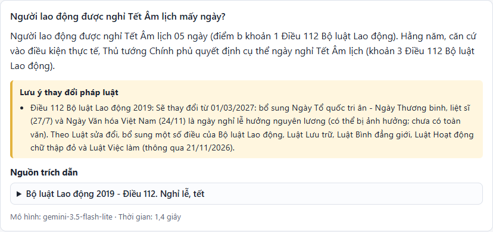

# Vietnamese Labor Law Assistant (RAG)

Question answering over Vietnamese labor law (Bộ luật Lao động 2019, Nghị định 145/2020) with retrieval on PostgreSQL + pgvector, LangGraph orchestration and LLM answers that cite every article and clause.

> Work in progress: M1 (corpus and parsing), M2 (index and retrieval), M3 (LangGraph flow with Gemini answers), M4 (API and chat UI) and M5 (answer evaluation, Docker, CI) are done; M6 (polish) next. See [docs/ARCHITECTURE.md](docs/ARCHITECTURE.md) for the design and milestones.

**Not legal advice.** Notice shown with answers: *Theo VBHN 125/VBHN-VPQH (2025); một số quy định sẽ thay đổi từ 01/03/2027.* The Labor Code is the consolidated text 125/VBHN-VPQH (the law in force, including amendments up to 27/08/2025); Nghị định 145/2020/NĐ-CP is the original text. Changes announced after that are tracked in [an amendment registry](#amendments) and flagged on the articles they touch.

## Corpus

| Document | Short id | Articles | Source |
|---|---|---|---|
| Bộ luật Lao động 45/2019/QH14, consolidated text 125/VBHN-VPQH (27/08/2025) | `BLLD2019` | 220 (17 chapters) | [Công báo 1309+1310](https://congbao.chinhphu.vn/van-ban/van-ban-hop-nhat-so-125-vbhn-vpqh-46084.htm); law page on [vanban.chinhphu.vn](https://vanban.chinhphu.vn/?pageid=27160&docid=198540) |
| Nghị định 145/2020/NĐ-CP | `ND145` | 115 (+ 6 appendices) | [vanban.chinhphu.vn](https://vanban.chinhphu.vn/?pageid=27160&docid=201967), text from [Công báo 1203–1206](https://congbao.chinhphu.vn/van-ban/nghi-dinh-so-145-2020-nd-cp-32732.htm) |

Vietnamese normative legal documents are not protected by copyright (Law on Intellectual Property, Art. 15), so the extracted text is kept in the repo.

## Quick start

Requires Python 3.10+ and Docker (for PostgreSQL + pgvector).

```bash
python -m venv .venv
# Windows: .venv\Scripts\activate    macOS/Linux: source .venv/bin/activate
pip install --no-cache-dir torch --index-url https://download.pytorch.org/whl/cpu   # CPU-only PyTorch first
pip install -e ".[dev]"            # app + tests
pip install -e ".[ingest]"         # only to re-extract text from the PDFs (PyMuPDF, AGPL)

# M1: corpus
python -m vnlaw_rag.cli fetch      # download the gazette PDFs to data/raw (3 requests)
python -m vnlaw_rag.cli parse      # PDF -> data/interim -> data/processed

# M2: index and retrieval
docker compose up -d db            # pgvector/pgvector:pg16 on 127.0.0.1:5442
python -m vnlaw_rag.cli index      # embed 348 chunks with bge-m3 and load them (one command)
python -m vnlaw_rag.cli search "Thời gian thử việc tối đa là bao lâu?"
python -m vnlaw_rag.cli eval       # retrieval metrics -> docs/EVAL.md

# M3: answers (needs GEMINI_API_KEY in .env)
python -m vnlaw_rag.cli ask "Người lao động được nghỉ Tết Âm lịch mấy ngày?"

# M4: API + chat UI on http://127.0.0.1:8000 (one process; stop it when not in use)
python -m vnlaw_rag.cli serve

pytest                             # offline; DB integration tests skip if no database
ruff check . && ruff format --check .
```

- `parse` works without the PDFs or PyMuPDF: it then reuses the committed `data/interim/*.lines.jsonl`. It downloads the bge-m3 tokenizer file once (to count chunk tokens exactly).
- `index` downloads bge-m3 once (about 2.3 GB). The model revision is pinned (`EMBEDDING_REVISION`, the Hub's safetensors conversion of the same weights), so only one weight file is cached and offline runs work. Embedding all 348 chunks takes about 8 minutes on a laptop CPU; vectors are cached in `data/cache/` by the hash of each chunk's text, so after a corpus update only changed chunks are embedded again (5 chunks, 9.6 s, for the switch to the consolidated text).
- Use `127.0.0.1` rather than `localhost` in `DATABASE_URL` on Windows: `localhost` tries IPv6 first and the container port is bound to IPv4 only, which costs a connection timeout.
- Configuration is read from environment variables or `.env` (see `.env.example`).
- **LLM:** Google Gemini API, free tier, official `google-genai` SDK. Model `gemini-3.5-flash-lite`, fallback `gemini-3.8-flash`, chosen by measured success rate and latency on 2026-11-24 ([decision 008](docs/decisions/008-llm-latency-policy-and-streaming.md)); change with `LLM_MODEL` / `LLM_FALLBACK_MODEL`. **On the free tier Google may use the requests to improve its products**: the app sends only the question and public legal text; do not type personal data into questions.

## Retrieval results

Golden set: 77 questions drafted by the coding agent (may be biased); the owner reviewed a stratified sample of 25 and accepted 22 (the 3 left blank were the out-of-scope items). Main numbers below are on the **22 reviewed answerable questions**, a small sample: one question moves Hit@k by 4.5 points. Full tables (all 77, per type, date, git revision): [docs/EVAL.md](docs/EVAL.md).

| Configuration | Hit@1 | Hit@5 | MRR@10 |
|---|---|---|---|
| **vector only, bge-m3 (default)** | 0.864 | 0.909 | 0.891 |
| keyword: syllable pairs + BM25-style IDF in SQL | 0.591 | 0.773 | 0.667 |
| keyword: syllable pairs + `ts_rank_cd` | 0.045 | 0.227 | 0.152 |
| hybrid RRF (vector + IDF keyword, function words dropped) | 0.773 | 0.955 | 0.829 |

On all 67 answerable questions: vector Hit@5 0.955 / MRR@10 0.858, hybrid 0.940 / 0.768. Vector-only is the default: hybrid finds one more reviewed question in the top 5 but ranks the right article lower on average ([decision 005](docs/decisions/005-retrieval-mode-vector-default.md)); it stays available with `RETRIEVAL_MODE=hybrid`.

### Reviewing the golden set

```bash
python -m vnlaw_rag.cli review-export                      # data/eval/review-golden.xlsx, 25 questions
# fill the "Đánh giá" column (Đúng / Cần sửa / Bỏ), edit cells if needed, then:
python -m vnlaw_rag.cli review-import data/eval/review-golden.xlsx
pytest tests/test_eval.py                                  # re-checks evidence quotes
```

## Answer results

`python -m vnlaw_rag.cli eval-answers`, generator and judge `gemini-3.5-flash-lite`, run sequentially. Numbers for the current configuration (`GRADE_MIN_SCORE=0.50`): the full run of 2026-11-24 (git 830902c, 148 API requests, 11 failed = 7.4%, all 77 questions scored) with the 2 questions affected by the later threshold change re-run (git aed54ed, 3 requests, 0 failed). Deterministic metrics are the main numbers; the LLM judge is the same model as the generator, so its scores are a sanity check only.

| Metric | Reviewed (n=22) | All (n=77) |
|---|---|---|
| Answered (answerable questions) | 0.909 | 0.955 |
| Citation precision / recall (article level) | 0.975 / 0.950 | 0.948 / 0.977 |
| Numeric exact match (key figure) | 7/8 | 22/23 |
| Out-of-scope questions refused | - | 10/10 |
| Judge correctness / faithfulness, 1-5 (secondary) | 5.00 / 4.95 | 4.94 / 4.97 |

The 3 remaining wrong refusals are retrieval misses (the right article was ranked too low or not found): the model answered "không tìm thấy" instead of guessing. The full run (answered 0.864 / 0.940 under the old 0.55 threshold) and every post-run change are in [docs/EVAL.md](docs/EVAL.md) and [decision 009](docs/decisions/009-answer-evaluation.md).

## How a question is answered

LangGraph flow: `route -> (lookup | retrieve) -> grade -> (generate | not_found) -> finalize`.

- **route**: an explicit reference ("Điều 35", "khoản 2 Điều 113 BLLĐ", "dieu 21 nghi dinh 145") is looked up directly; other questions go to retrieval.
- **grade**: if the best cosine similarity is below 0.50 the answer is "không tìm thấy" without calling the LLM.
- **generate**: Gemini returns structured JSON `{answer, citations[chunk_id], sufficient}`. Citations are checked in code against the retrieved chunks; unknown ids are removed and logged. Uncited or insufficient answers become "không tìm thấy".
- **warnings**: amendment notes of the cited articles (for example "Điều 112 ... Sẽ thay đổi từ 01/03/2027 ...") are attached by code, not left to the model.
- Details: [decision 007](docs/decisions/007-gemini-generation-and-citation-checks.md). Tests run the whole graph with a fake LLM; CI never calls the API.

## API and UI

`python -m vnlaw_rag.cli serve` starts one FastAPI process (bge-m3 and the database pool are loaded once, 2-3 GB of RAM).

| Endpoint | Purpose |
|---|---|
| `GET /` | Chat UI (Vietnamese): streamed answer, citation chips that open the cited text and the official link, amendment warnings, model and time, disclaimer |
| `POST /api/ask` `{question, top_k?}` | JSON: `answer, status, citations, warnings, notice, model, sources, timings_ms` |
| `GET /api/ask/stream?question=` | Server-Sent Events: `progress` (đang tìm, đã tìm thấy N Điều, đang soạn, chuyển model), `token`, then `result` or `error` |
| `GET /api/articles/{doc}/{n}` | One article: structure, text, amendment notes |
| `GET /health` | Status, model, index size, corpus notice |

Latency policy: each Gemini call has a hard 25 s limit; a timeout, 503, 429 or stream error switches to the other model at once (main, fallback, main); the whole answer has a 60 s budget, then the UI shows a Vietnamese error message.

Model choice, measured with `python -m vnlaw_rag.cli bench-llm` (5 reviewed questions per model, 2026-11-24): gemini-3.5-flash-lite answered 4/5 (p50 1.7 s, p95 2.0 s); gemini-4-hydrogen and gemini-3.8-flash answered 0/5 within 25 s. Details and fallback checks: [decision 008](docs/decisions/008-llm-latency-policy-and-streaming.md).

| Answer with citation | Holiday question with the 01/03/2027 warning | Out of scope |
|---|---|---|
|  |  |  |

Screenshots taken in Microsoft Edge with `scripts/screenshots.py` (Playwright, system browser, no download) against a local server; answers took 2.3 s, 1.4 s and 0.1 s.

## Docker and CI

```bash
docker compose up -d --build                                   # db + app on http://127.0.0.1:8000
docker compose run --rm app python -m vnlaw_rag.cli index      # once: load the chunks into pgvector
```

- The image (`python:3.11-slim`, CPU-only PyTorch) holds the code and `data/processed`; bge-m3 is downloaded on first start into the `hf-cache` volume (2.2 GB), and `./data/cache` is mounted so re-indexing reuses the embeddings.
- `GEMINI_API_KEY` comes from `.env` (optional file; without a key the app still serves retrieval and article lookups, and questions return an error message).
- The app container is limited to 4 GB of RAM. Checked on 2026-11-24 (Docker Desktop, WSL2): image 2.16 GB; the index loaded 348 chunks from the embedding cache without loading bge-m3; `/health` answered 15 s after start, with the container at 831 MiB; the Linux image passed the 133 tests against the compose database.
- That check reused an existing bge-m3 download instead of the volume: mount the model folder read-only and set `HF_HUB_OFFLINE=1` in a compose override (`- ~/.cache/huggingface/hub/models--BAAI--bge-m3:/models/hf/hub/models--BAAI--bge-m3:ro`).
- **CI** (`.github/workflows/ci.yml`): ruff and pytest on Python 3.10 and 3.11, with a `pgvector/pgvector:pg16` service container for the integration tests. Tests use a fake LLM and fake embeddings: CI never calls the Gemini API and never downloads bge-m3.

## Data layout

| Path | Content | Committed |
|---|---|---|
| `data/raw/*.pdf`, `data/raw/manifest.json` | Gazette PDFs; manifest with url, retrieved_at, sha256 | manifest only |
| `data/interim/<DOC>.lines.jsonl` | PDF text lines with bold flag and x position | yes |
| `data/processed/articles.jsonl` | One record per Điều, with nested Khoản / Điểm | yes |
| `data/processed/appendices.jsonl` | Phụ lục (lists in full, forms as a table of contents) | yes |
| `data/processed/chunks.jsonl` | Retrieval chunks with metadata | yes |
| `data/processed/build_info.json` | Counts, parameters, input hashes, parser anomalies | yes |
| `data/amendments.json` | Amendment registry: status, effective date, affected articles, official source | yes |
| `data/cache/*.npz` | Cached chunk embeddings, keyed by text hash | no |
| `data/eval/golden.jsonl` | Golden set: questions, expected articles, evidence quotes, reference answers | yes |
| `data/eval/retrieval_results.json` | Per-question ranks of the last retrieval eval | yes |
| `data/eval/review-golden.xlsx` | Review workbook for the owner | yes |

## Design decisions

- [001 Corpus source and PDF extraction](docs/decisions/001-corpus-source-and-pdf-extraction.md)
- [002 Layout-aware legal parser](docs/decisions/002-layout-aware-legal-parser.md)
- [003 Article-level chunking](docs/decisions/003-article-level-chunking.md)
- [004 Own pgvector SQL instead of langchain-postgres](docs/decisions/004-own-pgvector-sql-instead-of-langchain-postgres.md)
- [005 Default retrieval: vector-only, hybrid measured](docs/decisions/005-retrieval-mode-vector-default.md)
- [006 Consolidated text and amendment registry](docs/decisions/006-consolidated-text-and-amendment-registry.md)
- [007 Gemini generation, verified citations, code-level warnings](docs/decisions/007-gemini-generation-and-citation-checks.md)
- [008 LLM latency policy and streaming](docs/decisions/008-llm-latency-policy-and-streaming.md)
- [009 Answer evaluation: deterministic metrics first, LLM judge second](docs/decisions/009-answer-evaluation.md)

## Amendments

`data/amendments.json` (checked 2026-11-24 on official sources) drives the `amended_by` and `upcoming_change` fields of each chunk:

| Amending document | Status | Effective | Articles | In the text? |
|---|---|---|---|---|
| Luật Công nghiệp công nghệ số 71/2025/QH15 | in force | 01/01/2026 | BLLĐ Điều 154 khoản 8a (from the VBHN footnote) | yes (VBHN 125) |
| Law amending the Labor Code and four other laws, passed 21/11/2026 ([Báo Chính phủ](https://baochinhphu.vn/quoc-hoi-dong-y-bo-sung-2-ngay-nghi-le-duoc-huong-nguyen-luong-102261121121448218.htm)) | passed, text not yet published | 01/03/2027 | inferred from the topics: Điều 52-58 (labor leasing), 65-74 (collective bargaining), 92 (wage council), 112 (public holidays), 198-211 (strikes); NĐ 145 Điều 21-29, 49-53 | no: flagged as upcoming |
| Draft decree amending Nghị định 145 (July 2026) | draft | none | none | recorded only, never used in answers |

When the amending law is published in Công báo, its number and exact articles replace the inferred ones; when a new consolidated text appears, the corpus moves to it.

## License

MIT ([LICENSE](LICENSE)). PyMuPDF (AGPL-3.0) is used only by the optional, offline ingest step (`pip install -e ".[ingest]"`); the application does not depend on it.
